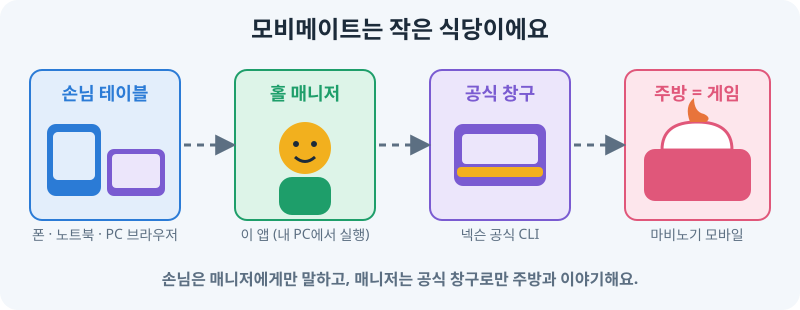
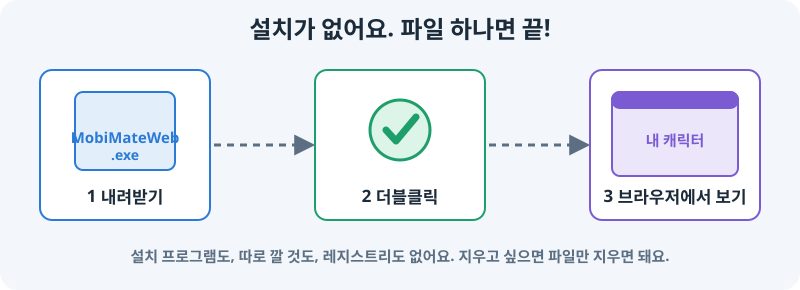
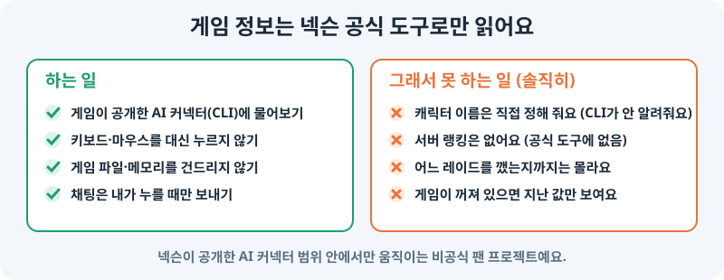
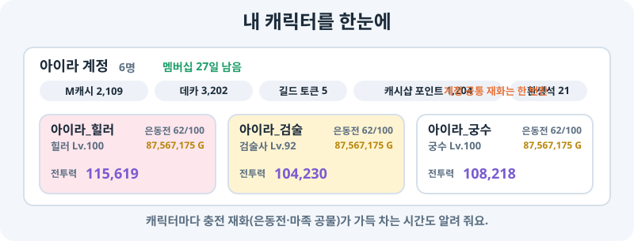
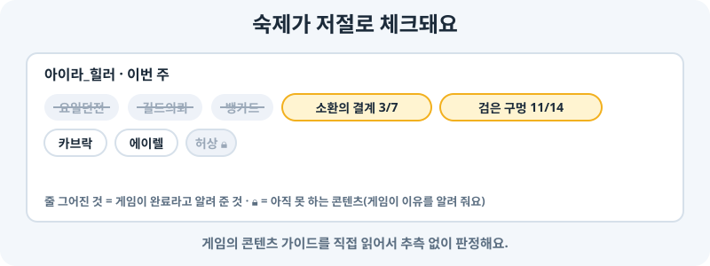
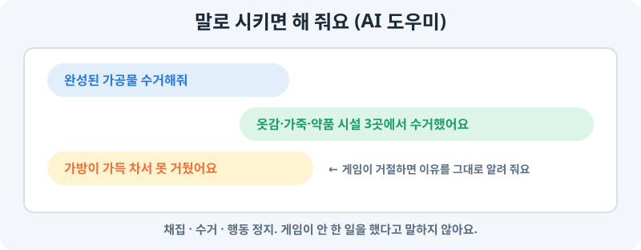
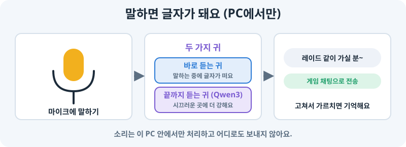
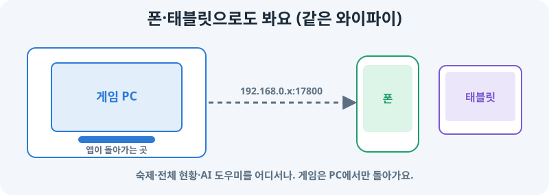

# 모비메이트 (MobiMate)

> 마비노기 모바일 도우미. **파일 하나**만 실행하면 돼요. 설치는 없어요.

---

## 1. 설치가 없어요

1. [Releases](https://github.com/seungwoonlee/mobimate/releases)에서 **MobiMateWeb.exe**를 받아요.
2. 더블클릭해요.
3. 브라우저에서 `http://127.0.0.1:17800` 을 열어요.

- .NET도, 설치 프로그램도 필요 없어요. 필요한 것이 전부 한 파일 안에 들어 있어요.
- 지우고 싶으면 파일을 지우면 끝이에요. 기록은 `%APPDATA%\MobiMateWeb` 폴더에만 남아요.
- 게임에서 **설정 → 게임 → AI 커넥터**를 켜 두세요. (처음 한 번)

## 2. 공식 CLI만 써요

모비메이트는 넥슨이 게임에 넣어 둔 **공식 CLI**(`MabinogiMobile_CLI.exe`)에게 물어보는 방법만 써요.

- 화면을 훔쳐보거나, 키보드를 대신 누르거나, 게임 통신을 엿듣지 않아요.
- 그래서 **공식 CLI가 알려 주지 않는 것은 몰라요.**
  - **캐릭터 이름은 직접 입력**해야 해요. (CLI가 이름을 알려 주지 않아요)
  - 서버 랭킹은 없어요.
  - 어느 레이드를 깼는지처럼 CLI에 없는 정보는 추측하지 않고 비워 둬요.
- 게임이 꺼져 있으면 마지막으로 본 값만 보여 줘요.

## 3. 기능을 하나씩 볼게요

### 전체 현황 — 내 캐릭터를 한눈에

- 캐릭터마다 전투력, 충전 재화(은동전·마족 공물)가 가득 차는 시간, 접속 시간을 보여 줘요.
- **계정이 같이 쓰는 재화**(M캐시·데카·길드 토큰·패키지 포인트·캐시샵 포인트·환생석·웨카)는 카드마다 적지 않고 계정 위쪽 한 줄에 한 번만 보여 줘요.
- 멤버십 남은 날도 같이 보여 줘요.

### 숙제 — 저절로 체크돼요

- 요일던전·길드의뢰·뱅가드·소환의 결계·검은 구멍·필드 보스·레이드·어비스를 게임이 알려 주는 대로 체크해요.
- 아직 못 하는 콘텐츠는 게임이 알려 주는 이유(예: "85레벨에 사용할 수 있습니다")를 그대로 보여 줘요.
- 틀리면 칸을 눌러 직접 고칠 수 있어요.
- 같은 기록을 쓰는 **숙제 전용 작은 앱**(`hw/`)도 들어 있어요.

### AI 도우미 — 말로 시켜요

- 가공물 수거, 채집, 행동 정지를 시킬 수 있어요.
- 게임이 거절하면(가방이 가득 참 등) **한 것처럼 말하지 않고** 이유를 그대로 알려 줘요.

### 음성 입력 — 말하면 글자가 돼요 (PC 전용)

- 말하는 중에 글자가 바로 뜨는 엔진(Zipformer)과, 끝까지 듣고 정확하게 적는 엔진(Qwen3-ASR) 중에서 설정에서 골라요.
- 소리는 PC 밖으로 나가지 않아요. 쓰지 않을 때는 메모리에서 내려요.

### 폰·태블릿에서 보기

- 폰 모양 버튼에 나오는 주소로 같은 와이파이에서 접속해요. 안 열리면 `allow-lan-firewall.bat`을 한 번 실행해요.
- 폰에서 내린 명령은 **게임이 돌아가는 PC**에서 실행돼요.

### 그 밖에

- **생활**: 가공 완료 시간, 생활 스킬 레벨과 경험치
- **가방·재화**: 늘고 준 양
- **긴급 정지**: `Esc`

## 알아 두세요

- 넥슨과 관계없는 **비공식 팬 프로젝트**예요.
- 기록은 내 PC에만 저장돼요. 외부 AI 서비스를 연결해서 쓰면 그때 보낸 질문은 그 서비스로 가요.
- 숙제 판정이 틀릴 수 있어요. 눌러서 고치면 돼요.
- 문제는 [Issues](https://github.com/seungwoonlee/mobimate/issues)에 남겨 주세요.

---

## 개발자에게

| 폴더 | 내용 |
|---|---|
| `web/` | 웹앱 본체 (MobiMate.Core · MobiMate.Web · React 클라이언트) |
| `hw/` | 숙제 전용 WPF 앱 (웹앱과 기록 파일을 같이 씀) |
| `legacy-wpf/` | 옛 WPF판 (보관용) |
| `docs/` | 조사·설계 문서, README 그림 |

빌드·배포·규칙은 [CLAUDE.md](CLAUDE.md)와 [web/DEVELOPMENT.md](web/DEVELOPMENT.md)를 보세요.
